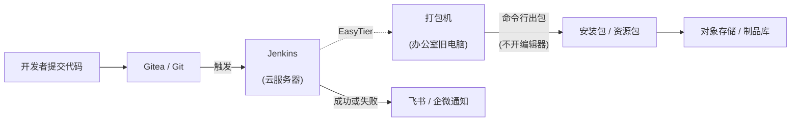
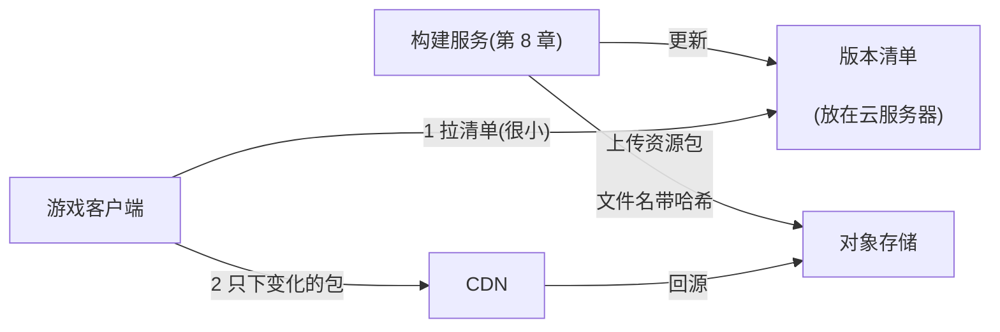

# 个人云服务器玩法推荐

‍

## 背景

‍

个人云服务器指租用或自有、具有公网 IP 的主机，常见形态为云厂商的 VPS 或轻量应用服务器，可为小团队与个人项目提供低成本的网络基础设施。

‍

---

‍

## 1. 个人云服务器的应用场景

‍

在游戏开发中,可能有以下几类对服务器的需求:

‍

* **联机**
* **版本管理与协作**
* **大文件传输**:美术资源和安装包体积可能较大,通用即时通讯工具和网盘存在大小与速度限制。
* **项目归档**

‍

这些需求均可由一台具有公网 IP 的服务器承担。

‍

## 2. 基础配置

‍

### 2.1 机器选型与带宽限制

‍

选型时,出口带宽通常先于 CPU 和内存成为瓶颈。以 300MB 资源包为例,在 5Mbps 带宽下,单用户下载的理论耗时为 300MB × 8 ÷ 5Mbps ≈ 480 秒,多用户并发时耗时进一步增加。

‍

据此有以下选型依据:

‍

* 带宽较小的机器不宜直接分发大文件,该问题在第 9 章热更资源中进一步讨论。
* 游戏服务器宜选用不限流量的固定带宽。阿里云为幻兽帕鲁推荐的是 3M 至 10M 不限流量。
* 存储宜选用 SSD。Palworld 官方文档指出,低性能存储可能导致存档损坏。
* 实例应具备快照功能,用于数据回滚。

‍

### 2.2 域名与备案

‍

备案要求取决于服务器所在地域:

‍

* **中国内地**:域名（无论是否由国内域名服务商注册）解析到该服务器并对外提供网站服务时,需要完成 ICP 备案。未备案时,云厂商会扫描端口并检测到该服务,可能临时封禁域名或服务器。
* **非内地地区**:按阿里云文档,不需要工信部 ICP 备案(公安备案要求以平台当时的规定为准)。

‍

备案的时间要求如下:

‍

* 域名须先完成实名认证,认证信息同步至管局约需三天。
* 备案周期不固定,需在服务上线前预留。
* 备案完成前可通过 DNS 验证方式申请证书,但网站仍无法通过域名访问。刚配置解析时网站短期内可能可以访问,但被服务商检测到后会被封禁,存在风险。

‍

不涉及备案的方案有两种:一是选用非内地机房,价格与延迟需另行评估;二是不配置域名解析,直接通过 IP 访问,但不能提供网页类信息服务。

‍

### 2.3 HTTPS 与证书续期

‍

Let's Encrypt 提供免费证书,有效期为 90 天,设计上要求续期自动化。配置要点如下:

‍

1. 域名解析到服务器,使用 `dig +short 域名`(Linux)或 `nslookup 域名`(Windows)确认返回的 IP 正确。
2. 安全组放行 **80 与 443**。签发和续期的验证走 80 端口,该端口须长期开放。
3. 使用 certbot 签发。首次建议添加 `--staging` 参数验证流程,避免触发频率限制。
4. Nginx 配置引用 `fullchain.pemcert.pem` 缺少中间证书,部分客户端会报证书链不完整。
5. 配置完成后执行 `certbot renew --dry-run`,验证续期链路。

‍

Let's Encrypt 已于 2025 年停止发送证书到期提醒邮件,需自行通过监控或脚本检查到期时间。

‍

### 2.4 上线前的安全配置

‍

资料中列出的常见入侵途径包括 SSH 弱口令、Redis 等服务未设密码即对外开放,以及 Web 应用漏洞。个人服务器缺少持续监控,这类风险更高。上线前至少完成以下三项配置。

‍

**(1)SSH 仅使用密钥登录**

‍

```bash

ssh-keygen -t ed25519 -C "my-server"

```

‍

公钥上传后,在新终端中验证密钥登录成功,再修改 `/etc/ssh/sshd_config`:

‍

```text

PasswordAuthentication no

PermitRootLogin no

```

‍

配置修改前必须保留原会话,并在新会话中验证。配置错误会导致无法登录,恢复需通过云厂商的 VNC 控制台。

‍

修改 SSH 默认端口(如 22 改为 2222)不提高安全性,扫描工具会遍历全部端口;实际有效的措施是密钥登录和来源 IP 限制。

‍

**(2)安全组/ufw默认拒绝**

‍

仅向公网开放 80 与 443。22 端口尽量限制来源 IP。数据库、Redis 等端口(3306、6379、27017)不向 `0.0.0.0/0` 开放。

‍

**(3)Docker 发布端口绕过主机防火墙**

‍

通过 `docker run -p 8080:80` 发布的端口会直接写入 iptables,绕过 UFW。即使 UFW 未放行 8080,外网仍可访问该端口。

‍

解决方式之一是仅绑定回环地址,再由主机上的 Nginx 反向代理:

‍

```bash

docker run -d -p 127.0.0.1:8080:80 nginx

```

‍

服务器遭受挖矿入侵的典型表现是 CPU 长时间处于 80% 以上。阿里云建议的第一步处置是在安全组中将出方向规则全部设为拒绝,以切断与矿池的连接,再进行排查。

‍

---

‍

## 3. 博客方案选型

‍

选型依据三个问题:

‍

1. 是否需要在网页后台撰写文章。
2. 是否接受维护数据库。
3. 是否需要会员、订阅等功能(多数个人博客不需要)。

‍

| 方案 | 类型 | 内存参考 | 适用情况 |

| --- | --- | --- | --- |

| Typecho | 动态,PHP | 512MB | 需要网页后台,希望维护成本低 |

| Halo | 动态,Java | 2GB 起 | 需要现代化后台与插件市场 |

| Hugo | 静态 | 服务器仅运行 Nginx | 熟悉 Git 与 Markdown,重视构建速度 |

| Hexo | 静态 | 同上 | 熟悉 Node.js,依赖中文主题生态 |

‍

对具备开发背景的作者,静态博客的优势如下:

‍

* 文章为 Markdown 文件,可直接纳入 Git 管理。
* 线上无运行时和数据库,攻击面小,无需持续跟进安全更新。
* 内容层均为 Markdown,更换方案时仅需重写模板。

‍

静态方案的局限在于缺少网页后台,发布需经过"编辑 Markdown、构建、推送"流程;评论与站内搜索依赖第三方服务。需要在手机端随时撰写时,Typecho 或 Halo 更为合适。

‍

静态博客也可托管在 Cloudflare Pages 或 GitHub Pages,不占用自有服务器。

‍

---

‍

## 4. 联机游戏服

‍

取决于游戏。

‍

## 5. EasyTier 异地组网

‍

### 5.1 问题与方案分类

‍

参与者分处不同网络且无公网 IP 时,需要通过异地组网实现"类局域网"的互访。典型用途包括:

‍

* 联机运行仅支持局域网的游戏。
* 访问家庭 NAS 上的文件。
* 访问他人电脑上运行的 demo 服务。

‍

常见方案有 EasyTier、ZeroTier、Tailscale。frp 属于内网穿透,原理不同,但常被用于同类场景,故一并对比。

‍

### 5.2 方案对比

‍

| 维度 | EasyTier | ZeroTier | Tailscale | frp |

| --- | --- | --- | --- | --- |

| 核心思路 | 去中心化,节点平等 | 虚拟二层网络,有控制器 | 基于 WireGuard 的 mesh,账号体系 | 反向代理,经自有服务器转发 |

| 是否需要自有服务器 | 不一定,可用公共共享节点,也可自建 | 不需要 | 不需要 | **需要**公网服务器 |

| 打洞失败后 | 经共享节点中继,路径可控 | 依赖官方根节点;Moon 为辅助根,不等同于通用中继 | 经官方 DERP 中继 | 流量始终经自有服务器 |

| 二层广播 / mDNS | **不支持**(三层 TUN) | 支持 | 不支持 | 不适用 |

| 身份与权限管理 | 网络名 + 密钥 | 控制台授权成员 | 账号、ACL、MagicDNS,功能最完整 | token |

| 上手难度 | 低 | 低 | 最低 | 中等 |

| 适用场景 | 需要自控中继、国内跨城、游戏联机 | 需要二层、广播、多平台异构设备 | 个人设备互联、团队账号管理 | 公开少数 Web 或固定端口服务 |

‍

对比结论如下:

‍

1. 能够直连时,三种组网工具的业务流量均不长期经过第三方服务器,速度主要取决于两端网络。方案差异主要出现在打洞失败之后。
2. ZeroTier 的 Moon 是用户自定义根节点,作用是协助节点发现和建立路径,不是通用中继。官方文档已不再推荐新建私有 Moon,且不在 SLA 支持范围内。
3. EasyTier 主模式为三层 TUN,不提供二层虚拟以太网。依赖 ARP、mDNS、NetBIOS 等二层协议自动发现的软件,在 EasyTier 网络中可能无法发现对端。部分局域网游戏的房间自动发现属于此类,需要实测验证,或改用手动输入 IP 连接。
4. 各方案不存在全面优劣关系。资料中的一种总结是:Tailscale 产品完成度高、部署省力;已稳定使用 ZeroTier 时无需迁移;EasyTier 适合需要自建中继、控制路径的场景。从零开始、仅需快速连接少量设备时,Tailscale 通常部署成本最低。

‍

### 5.3 EasyTier 的特性

‍

* **去中心化**:所有节点平等,无服务端与客户端之分。设备只要能连通网络中任一节点,即可加入。
* **入网方式**:网络名与密钥相同的节点属于同一个虚拟网络。
* **图形界面**:提供 GUI,不要求使用命令行。
* **子网代理**:节点可将所在局域网整体共享给其他节点,可用于 NAS 场景。
* **加密**:支持 AES-GCM 或 WireGuard。
* **NAT 穿透**:支持 UDP 穿透,官方称在 NAT4 对 NAT4 环境下可工作。

‍

  
‍

‍

*图 1 EasyTier GUI 配置页。联网方式包括 Public Server(公共节点)、Manual(手动指定)、Standalone(单机)。来源:EasyTier 官方 GitHub 仓库。*

‍

  
‍

‍

*图 2 EasyTier GUI 运行页,显示已连接节点数、上下行速率和 Peer 列表。来源:EasyTier 官方 GitHub 仓库。*

‍

### 5.4 自建共享节点

‍

EasyTier 可通过公共共享节点完成节点发现并尝试打洞,打洞失败时流量经节点中继。公共节点的位置和带宽不可控,因此可使用自有云服务器作为共享节点,结构见图 3。

‍

```mermaid

flowchart LR

    Cloud["云服务器

共享节点

(公网 IP)"]

    Me["节点 A

(用户电脑)"]

    Colleague["节点 B

(协作者电脑)"]

    NAS["节点 C

(家庭 NAS,共享 192.168.x.0/24)"]


‍

    Me <-->|"先连节点,再尝试 P2P 直连"| Cloud

    Colleague <-->|"同上"| Cloud

    NAS <-->|"同上"| Cloud

    Me <-.打洞成功后直连.-> Colleague

    Me <-.打洞成功后直连.-> NAS

```

‍

*图 3 自建共享节点拓扑。虚线为打洞成功后的直连路径,失败时数据回到实线,经云服务器中继。*

‍

云服务器上的启动命令:

‍

```bash

easytier-core --network-name <网络名> --network-secret <随机密钥> --private-mode true

```

‍

官方文档指出,EasyTier 的每个节点默认允许为其他虚拟网络转发流量,即使该节点已设置网络名与密钥。云服务器作为共享节点且不加限制时,会为其他网络提供免费中继,消耗自身带宽。因此应使用 `--private-mode true`,仅允许网络名与密钥匹配的节点连接。

‍

EasyTier 的本机 RPC 管理接口(资料示例为 `127.0.0.1:15888`)仅供本机 `easytier-cli` 使用,与 P2P 和中继无关,应仅监听本机,不暴露到公网。

‍

默认监听端口为 TCP/UDP 11010,另有 WebSocket 11011、WSS 11012、WireGuard 11013。仅开放实际使用的端口。云安全组与主机防火墙为两层配置,需各自放行。

‍

### 5.5 连接路径验证

‍

组网后,通过以下命令判断连接是直连还是中继:

‍

```bash

easytier-cli peer

easytier-cli route

```

‍

  
‍

‍

*图 4* `route` *命令输出示例,包含对端虚拟 IP、主机名、代理子网(proxy\_cidrs)、下一跳和延迟。来源:EasyTier 官方 README。*

‍

直连成功时,云服务器基本不承载两端的业务流量。仅在中继生效时,云服务器的带宽与线路才成为瓶颈。传输速度偏低时,应先确认是否处于中继状态。

### 5.6 多工具共存时的网段规划

‍

多种组网工具可同时存在于同一设备,常见问题包括虚拟网段重复、路由冲突和 DNS 互相覆盖。共存时,各网络应规划互不重叠的网段,且不应让两个 VPN 同时发布同一个家庭网段。不建议在每台设备上同时安装全部工具。

‍

---

‍

## 6. Git 与 LFS

‍

### 6.1 二进制资源的版本管理问题

‍

`.uasset.fbx.psd.wav` 等文件具有体积大、不可合并、每次改动均整体存储的特点。直接提交到 Git 会导致仓库膨胀、拉取变慢,且历史版本无法清除。

‍

解决方案是 Git LFS(Large File Storage):仓库中仅保存指针,大文件存放在 LFS 存储中。

‍

图 5 为 Gitea 官方教程中的 Unreal 项目示例,仓库大小为 1.2 GiB,目录包含 Assets、Engine`.gitattributes` 与 `.gitignore`。

‍

  
‍

‍

*图 5 Unreal 项目托管于 Gitea,仓库大小 1.2 GiB。来源:Gitea 官方教程《Using Gitea Cloud for game development》。*

‍

### 6.2 Gitea 启用 LFS

‍

Gitea 内置 LFS 支持,关键配置位于 `app.ini`:

‍

```ini

[server]

LFS\_START\_SERVER = true


‍

[lfs]

PATH = /data/git/lfs

```

‍

服务器需安装 Git,官方要求版本为 2.1.2 以上。Anchorpoint 教程中,Gitea 在 2GB 内存下可运行。

‍

客户端安装 `git-lfs` 后,指定需要走 LFS 的文件类型:

‍

```bash

git lfs install

git lfs track "\*.uasset" "\*.fbx" "\*.psd" "\*.wav"

git add .gitattributes

git commit -m "track binary assets with lfs"

```

‍

`.gitattributes` 须一并提交,否则其他成员拉取到的仍是原始大文件。

‍

### 6.3 常见问题

‍

1. Gitea 网页上传的 3MB 限制仅针对前端,通过 `git push` 与 LFS 推送不受该限制。
2. LFS 的存储体积包含历史版本。当前 10G 的项目经多次修改后可能占用 100G,而云服务器系统盘容量有限。
3. 磁盘不足时,可将 LFS 存储改为 S3 兼容的对象存储(配置项为 `STORAGE_TYPE = minio`)。Anchorpoint 教程采用该做法,服务器仅保留约 55GB 用于数据库,二进制文件存放在对象存储中。配置见图 6。

‍

  
‍

‍

*图 6 Gitea 的* `app.ini[server]` *中启用* `LFS_START_SERVER[storage]` *中配置 minio 类型的 S3 兼容对象存储（端点、访问密钥、存储桶、区域）。来源：Anchorpoint，Install and configure Gitea for LFS。*

‍

### 6.4 适用范围与局限

‍

Unreal 项目业内常用 Perforce。选型资料指出,GitLab 处理超大美术资源的 LFS 时,自身性能压力较大。

‍

Gitea + LFS 适用于个人项目、小团队、Unity 项目及资源总量较小的 demo。团队规模大、资源达数百 GB 的 Unreal 项目,需要评估 Perforce 等方案。

‍

二进制文件无法合并,多人协作时需依赖文件锁避免同时修改同一资源。Git LFS 提供 `git lfs lock`,Gitea 亦支持。

‍

---

‍

## 7. NAS 远程访问

‍

NAS 提供大容量存储,可弥补云服务器磁盘容量的不足。主要问题是 NAS 位于家庭网络,没有公网 IP,外部无法直接访问。

‍

### 7.1 访问方案对比

‍

| 方案 | 原理 | 前提 | 注意事项 |

| --- | --- | --- | --- |

| 组网(EasyTier / Tailscale / ZeroTier) | NAS 与访问设备加入同一虚拟网络 | 双方安装客户端 | 访问端均需安装软件,配置最简单 |

| frp | NAS 上的 frpc 主动连接云服务器的 frps,外部访问云服务器端口 | 一台公网服务器 | 流量经云服务器带宽;对外暴露的内容须严格限制 |

| Cloudflare Tunnel | 将 Web 应用接入域名 | 域名 | 主要适用于 Web,协议有限制;大流量媒体需核对条款 |

‍

NAS 中存放个人文件,无需对公网开放。使用组网方案时,仅授权设备可访问,暴露面较小。因此推荐 NAS 加入 EasyTier 网络用于私有访问,frp 仅用于必须公开的少量 Web 服务。

‍

### 7.2 子网代理

‍

不在 NAS 上逐个部署客户端、且需访问家庭内其他设备(如打印机、软路由)时,可由家庭内的某一节点共享整个局域网,即前述子网代理。图 4 中 `proxy_cidrs` 列显示的是该节点代理的网段。

‍

### 7.3 使用 frp 时的安全要求

‍

* `token` 须使用足够长的随机字符串,它是整套方案唯一的认证凭据。
* frp Dashboard(资料示例端口 7500)不应直接暴露到公网;不需要时关闭,或限制来源 IP。
* 仅映射必要端口。SSH、远程桌面、NAS 管理后台等高危端口,能不映射则不映射。
* 数据库端口(如 MySQL 3306)不宜暴露`token` 仅用于 frpc 与 frps 之间的认证,不替代数据库自身的账号权限。
* 无论采用哪种方案,均应保留不依赖隧道的局域网管理入口,以便隧道故障时仍可管理 NAS。

‍

---

‍

## 8. 延伸应用 A:构建出包服务

‍

### 8.1 问题背景

‍

游戏项目构建耗时较长。华为云的资料指出,代码量较大的项目一次完整编译需 20 至 60 分钟甚至更久,iOS 版本必须在 macOS 上编译签名。常见问题包括:

‍

* 构建占用开发者电脑,影响其他工作。
* 安装包在个人电脑上构建,环境不一致,问题难以复现。
* 向测试交付新包依赖人工操作。

‍

Rust 开发团队的案例:最初构建在个人电脑上完成,过程繁琐。后来改用 Jenkins,由 SVN 提交自动触发,客户端与服务端构建任务并行,构建时间从约 40 分钟降至 10 分钟以内。工具链为 Jenkins、SVN、S3,没有特殊组件。该案例的结论是,收益来自将工具落实并自动运行。

‍

### 8.2 小团队的结构

‍

选型资料给出的建议如下:

‍

| 团队规模 | Unity | Unreal |

| --- | --- | --- |

| 1 至 15 人 | TeamCity 免费版(3 个构建节点) | Jenkins + P4 |

| 15 至 50 人 | GitLab CI | TeamCity |

| 50 人以上 | Jenkins / Azure DevOps | Horde CI + UGS |

‍

对个人或小组场景,采用以下结构:

‍

* **云服务器承担调度**:运行 Jenkins 主节点,或 GitHub Actions 自托管 runner 的管理。
* **打包机承担构建**:办公室内磁盘和内存充足的旧电脑。游戏项目常达几十至上百 GB,4 核 8G 的云服务器无法承担。
* **云服务器与打包机之间通过 EasyTier 连接**,打包机无需公网 IP,也无需向公网开放端口。该组合为推论,资料中无对应案例,未经完整验证。

‍



‍

*图 7 构建出包流程*

‍

### 8.3 注意事项

‍

* Jenkins 仅负责调度,具体编译由 Unity 或 Unreal 的命令行工具执行,因此与引擎无关。
* iOS 构建必须使用 Mac 节点。
* 签名证书和私钥不应存放在打包机本地。华为云方案使用加密服务统一保管,编译时按需取用。个人使用时,至少不应将证书提交进代码仓库。
* 早期阶段应优先保证出包、测试和发布的自动化,不宜过早引入 Kubernetes。
* Jenkins 的缺点是维护成本高、插件冲突多,界面对美术和策划不够友好;优点是零授权费,资料最完整。

‍

---

‍

## 9. 延伸应用 B:热更资源 CDN

‍

### 9.1 带宽约束

‍

2.1 节的计算表明,300MB 资源包在 5Mbps 带宽下,单用户下载约需 8 分钟。资源直接由小带宽云服务器分发无法满足需求。

‍

因此热更资源的方案是:服务器仅存放清单,大文件存放于对象存储,并在其前部署 CDN。

‍

### 9.2 按内容哈希命名

‍

Rust 团队的做法如下:

‍

* 资源拆分为 60 余个小包,每个小于 5MB,使浏览器可像缓存图片一样缓存。
* 每个包以 CRC 哈希命名,仅在内容变化时文件名才变化,客户端才重新下载。
* 目的是避免玩家每次更新都下载 300MB 的内容。

‍

据此可推论:哈希命名的文件内容不变,缓存时间可设置得较长,基本无需手动刷新 CDN,仅清单文件需要较短缓存。该推论在资料中没有明确给出。

‍

### 9.3 版本分层

‍

| 层 | 示例 | 备注 |

| --- | --- | --- |

| 主版本 | 1.0、2.0 | 改动大,强制更新安装包 |

| 资源版本 | 1.0.1、1.0.2 | 走热更,仅更新变化的资源包 |

| 配置版本 | 独立管理 | 可随时更新,无需发新包 |

‍

客户端启动流程:下载清单,对比本地文件哈希,仅下载变化的文件(差分下载),流程见图 8。

‍



‍

*图 8 热更资源分发流程*

‍

### 9.4 注意事项

‍

* 大文件不通过云服务器带宽分发,服务器仅存放清单。
* 国内 CDN 的加速域名通常要求已备案,与 2.2 节相关,需在实施前确认。
* 个人 demo 阶段可先使用对象存储与哈希命名验证逻辑,流量增长后再引入 CDN。
* 清单文件须有版本记录和回滚机制。清单出错会使所有客户端获取到错误资源。

‍

---

‍

## 10. 注意事项汇总

‍

**机器与网络**

* 带宽先于 CPU 成为瓶颈,大文件不应直接经云服务器分发。
* 云安全组与主机防火墙分为两层,端口需各自放行。
* 购买前确认实例支持快照。

‍

**域名与证书**

* 内地服务器对外提供网站服务需 ICP 备案。域名实名认证信息同步约需三天。
* Let's Encrypt 验证使用 80 端口,须长期开放。证书有效期 90 天,须配置自动续期并通过 `--dry-run` 验证。
* Nginx 引用 `fullchain.pem`。
* Let's Encrypt 不再发送到期提醒邮件,需自行监控。

‍

**安全**

* SSH 仅使用密钥登录,修改配置前须在新会话中验证。
* 修改 SSH 端口不提高安全性。
* 数据库与 Redis 不向公网开放。
* Docker 发布的端口会绕过 UFW,应绑定 `127.0.0.1` 并通过反向代理对外提供。
* CPU 长时间处于 80% 以上时,应排查是否被挖矿,首先切断出方向流量。

‍

**组网**

* 自建 EasyTier 共享节点须设置 `--private-mode true`,RPC 接口仅监听本机。
* EasyTier 不支持二层广播,依赖局域网自动发现的游戏需先测试。
* ZeroTier 官方不推荐新建私有 Moon。
* 多种组网工具共存时,网段须相互错开。

‍

**Git**

* LFS 存储体积包含历史版本,磁盘不足时改用对象存储。
* `.gitattributes` 须提交。
* 大型 Unreal 项目需评估 Perforce。

‍

**运维**

* 热更资源按内容哈希命名,清单须具备回滚机制。

‍

---

‍

## 参考资料

‍

以下按章节整理。

‍

### 基础配置(第 2 章)

* [域名、企业和服务器备案的条件和备案流程 - 阿里云帮助中心](https://help.aliyun.com/zh/icp-filing/basic-icp-service/support/for-the-record-process-faq)
* [华为云 ECS 上用 Nginx + Let's Encrypt 配置 HTTPS 并自动续期](https://bbs.huaweicloud.com/blogs/512932)
* [如何给自己的服务器免费签发 SSL 证书:Certbot + Let's Encrypt](https://zhimayuandi.com/blog/free-ssl-letsencrypt-certbot/)
* [ECS (Ubuntu 22.04) 安全加固实战:SSH 密钥登录 + UFW + Fail2ban](https://bbs.huaweicloud.com/blogs/510904)
* [云服务器安全基线:上线前必须做的 9 项加固清单](https://rubcloud.com/blog/cloud-security-baseline/)
* [挖矿程序处理最佳实践 - 阿里云云安全中心](https://help.aliyun.com/zh/security-center/use-cases/best-practices-for-handling-mining-programs)

‍

### 博客(第 3 章)

* [不只是 WordPress:2026 年轻量博客系统选型指南](https://www.destlive.com/articles/lightweight-blog-systems-2026)
* [Halo 和 Typecho 对比 - Halo 官方](https://www.halo.run/archives/halo-typecho-blog-comparison)
* [2026 开源博客程序选型实测:十个候选的真相](https://blog.itswe.com/blog/deep-blog-cms-2026/)
* [从 Halo 迁移到 Hexo 静态博客](https://www.vemiy.com/posts/halo-to-hexo/)

‍

### 联机游戏服(第 4 章)

* [Palworld Server Guide:Requirements(官方)](https://docs.palworldgame.com/getting-started/requirements/)
* [2026 年游戏服务器搭建推荐:腾讯云轻量服务器](https://cloud.tencent.com/developer/article/2657649)
* [使用阿里云计算巢部署幻兽帕鲁服务器](https://developer.aliyun.com/article/1672522)
* [Minecraft game server in Yandex Cloud](https://yandex.cloud/en/docs/tutorials/infrastructure/minecraft-server)
* [How to Make a Minecraft Server (Paper)](https://www.arct.cloud/tutorials/make-minecraft-server)

‍

### EasyTier 组网(第 5 章)

* [EasyTier 简介(官方)](https://easytier.cn/guide/introduction.html)
* [搭建共享节点(官方)](https://easytier.cn/guide/network/host-public-server.html)
* [EasyTier README\_CN(GitHub,文中截图来源)](https://github.com/EasyTier/EasyTier/blob/main/README_CN.md)
* [从 ZeroTier 到 EasyTier 的异地组网实践](https://blog.iqzhi.com/posts/zerotier-to-easytier-private-networking/)
* [从"能连上"到"能管理":我折腾 Tailscale 的完整过程](https://blog.iqzhi.com/posts/tailscale-from-tinkering-to-practical-deployment/)
* [EasyTier vs Tailscale vs ZeroTier:国内跨城组网怎么选](https://etrelay.com/guides/easytier-vs-tailscale-zerotier.html)
* [Private Root Servers - ZeroTier 官方文档](https://docs.zerotier.com/roots/)
* [内网穿透与异地组网方案对比:frp、ZeroTier、Tailscale 怎么选](https://yyywe.com/posts/remote-access-solutions-compare)

‍

### Git 与 LFS(第 6 章)

* [Git LFS 设置 - Gitea 官方文档](https://docs.gitea.com/zh-cn/administration/git-lfs-setup/)
* [Using Gitea Cloud for game development(文中两张截图来源)](https://about.gitea.com/resources/tutorials/game-development-on-gitea-cloud/)
* [Install and configure Gitea for LFS - Anchorpoint](https://www.anchorpoint.app/blog/install-and-configure-gitea-for-lfs)
* [Can't setup big files upload (LFS?) - Gitea 论坛](https://forum.gitea.com/t/cant-setup-big-files-upload-lfs/5808)

‍

### NAS(第 7 章)

* [Connect to network attached storage (NAS) - Tailscale 官方](https://tailscale.com/docs/integrations/nas)
* [使用 frp 实现 NAS 内网穿透:云服务器与 Docker 部署指南](https://wungjyan.com/posts/frp-nas-remote-access/)
* [选择 Tailscale、ZeroTier 或自建远程通道 - fnOS 使用指南](https://fnos.einverne.info/guide/remote-access/private-network)
* [内网穿透完全指南:核心原理与 frp 实战精解](https://leafcxy.github.io/posts/2026/11/nat-traversal-frp-guide/)

‍

### 构建出包与热更(第 8、9 章)

* [游戏云上编译与持续集成/持续部署流水线 - 华为云](https://bbs.huaweicloud.com/blogs/489774)
* [Unity 与 Unreal 引擎的私有化 DevOps 选型](https://www.cnblogs.com/shiroe/p/19587963)
* [RUST - 多人游戏后台深度解析 - Edgegap](https://edgegap.com/zh/blog/rust-multiplayer-game-backend-deep-dive)
* [分布式游戏服务器架构开发准备](https://mr-liu-cheng.github.io/2026/01/30/%E5%88%86%E5%B8%83%E5%BC%8F%E6%B8%B8%E6%88%8F%E6%9C%8D%E5%8A%A1%E5%99%A8%E6%9E%B6%E6%9E%84%E5%BC%80%E5%8F%91%E5%87%86%E5%A4%87/)
* [团队基础设施及 DevOps 准备 - BitAction](https://www.cnblogs.com/bitaction/p/19871805)

‍

### 图片来源

* EasyTier 的三张图`easytier-config.pngeasytier-running.pngeasytier-route.png`)来自 [EasyTier 官方仓库](<https://github.com/EasyTier/EasyTier)。>
* `gitea-ue-repo.png` 来自 [Gitea 官方教程](<https://about.gitea.com/resources/tutorials/game-development-on-gitea-cloud/)。>
* `anchorpoint-gitea-lfs-storage.png` 截取自 [Anchorpoint 教程](<https://www.anchorpoint.app/blog/install-and-configure-gitea-for-lfs)中的> `app.ini` 配置图。
* 文中的 Mermaid 图为自绘。

  
‍